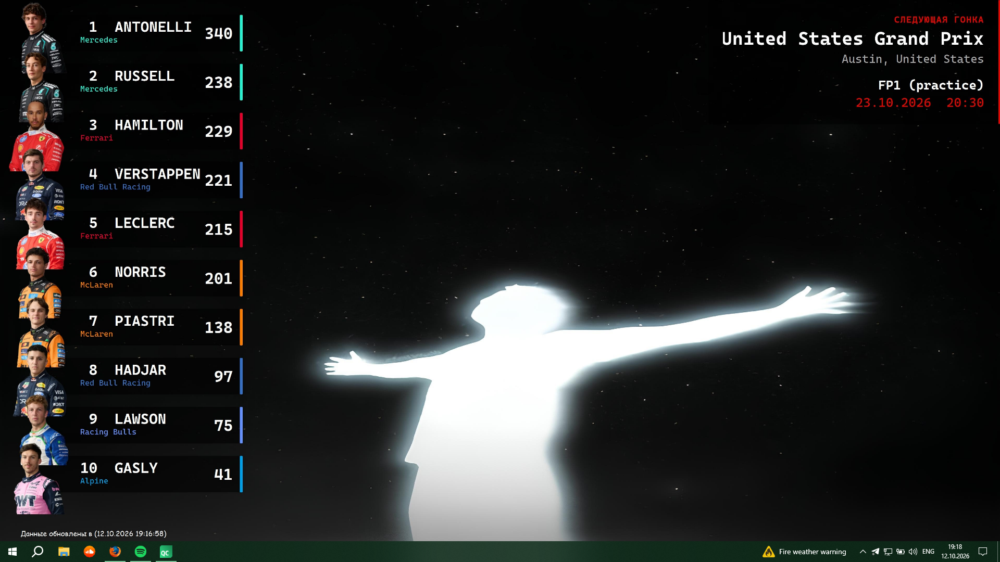
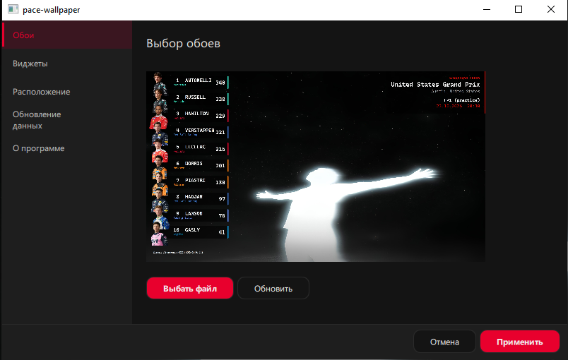

# 🏎️ Pace Wallpaper

Живые обои для рабочего стола со статистикой **Формулы 1**.

Программа сама собирает свежие данные текущего сезона и каждые **15 минут** перерисовывает обои: на них видно таблицу пилотов и информацию о ближайшей гонке.

> ⚠️ Проект в активной разработке.

---

## 📸 Скриншоты

### Результат на рабочем столе

### Окно настроек

---

## ✨ Возможности

- 🏆 **Таблица лучших пилотов сезона** (топ-10): место, фамилия, команда, очки и фото пилота
- 🎨 **Цвета команд** - у каждой команды своя цветная полоска
- 🏁 **Следующая гонка**: название Гран-при, место проведения, ближайшая сессия (FP1, квалификация, гонка), дата и время
- 🔄 **Автообновление каждые 15 минут**
- 🕒 **Время последнего обновления** прямо на обоях
- 🖼️ **Свой фон**: можно выбрать любую картинку через кнопку «Выбрать файл»
- ⚙️ Удобное окно настроек (тёмная тема, русский интерфейс)

---

## ⚖️ Дисклеймер

Проект **неофициальный** и никак не связан с Formula 1, FIA или командами. Все названия, логотипы и фотографии принадлежат их владельцам. Программа создана в личных, некоммерческих целях.
